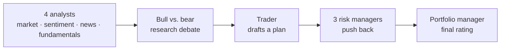

<p align="center">
  
</p>

<h1 align="center">TradingAgents for Windows and Android</h1>

<p align="center">
  A team of AI agents researches any stock and gives it a rating, on your PC or your phone.<br>
  No Python, no server, no setup. Install it and paste your AI provider's key.
</p>

<p align="center">
  <a href="https://github.com/ajisrawi/TradingAgents-Apps/releases/latest/download/TradingAgents-Setup.exe"></a>
  &nbsp;
  <a href="https://github.com/ajisrawi/TradingAgents-Apps/releases/latest/download/TradingAgents.apk"></a>
</p>

<p align="center">
  <a href="https://github.com/ajisrawi/TradingAgents-Apps/releases/latest"></a>
  
  
</p>

---

## Download

| | File | Size | Needs |
|---|---|---|---|
| **Windows** | [TradingAgents-Setup.exe](https://github.com/ajisrawi/TradingAgents-Apps/releases/latest/download/TradingAgents-Setup.exe) | ~54 MB | Windows 10 or 11, 64-bit |
| **Android** | [TradingAgents.apk](https://github.com/ajisrawi/TradingAgents-Apps/releases/latest/download/TradingAgents.apk) | ~80 MB | Android 7.0 or newer, 64-bit (arm64) phone |

All versions are on the [Releases page](https://github.com/ajisrawi/TradingAgents-Apps/releases).

## Install

### Windows

1. Download **TradingAgents-Setup.exe** and open it.
2. If Windows shows "Windows protected your PC", click **More info**, then **Run anyway**. This appears because the app isn't code-signed yet.
3. Click through the installer. No administrator rights are needed.
4. Open **TradingAgents** from the Start menu or the desktop shortcut.

To uninstall: **Settings → Apps → Installed apps → TradingAgents → Uninstall**.

### Android

1. Download **TradingAgents.apk** on your phone and open it.
2. If asked, allow your browser or file manager to **install unknown apps**.
3. Tap **Install**. If Play Protect warns about an unknown app, tap **More details → Install anyway**.
4. Open **TradingAgents**. The first start takes a little longer while it sets itself up.

## First run

1. Open **Settings** and paste the API key of the AI provider you use: OpenAI, Anthropic (Claude), Google (Gemini), DeepSeek, OpenRouter, Groq, and more. A local model through Ollama or LM Studio needs no key.
2. Go to **New analysis**, type a ticker such as `NVDA`, `AAPL` or `BTC-USD`, and press **Start analysis**.
3. Watch the agents work in **Live run**. Finished analyses stay in **History**.

A run makes dozens of AI calls and takes a few minutes. Your provider bills them to your key, so start with a cheaper model.

## How it works

The apps run [TradingAgents](https://github.com/TauricResearch/TradingAgents), an open-source research framework by Tauric Research, in which AI agents work like a trading desk:



The final rating is one of **Buy, Overweight, Hold, Underweight or Sell**, with every agent's full report.

- **Runs on your device.** On Android the whole framework runs on the phone itself. Nothing to pair, no server.
- **Your keys stay with you.** A key is stored only on your device (encrypted for your Windows account on PC, in the app's private storage on Android) and is sent only to the provider it belongs to.
- **Light and dark mode**, in Settings.

## Disclaimer

This is a research tool. Its output depends on the AI models and data used and is **not financial, investment or trading advice**. This project is not affiliated with Tauric Research.

## Credits

- [TradingAgents](https://github.com/TauricResearch/TradingAgents) by Tauric Research, Apache-2.0. The agent design is theirs; this project packages it as apps.
- Android packages from [Chaquopy](https://chaquo.com/chaquopy/) and [Flet's package index](https://pypi.flet.dev).

<details>
<summary><b>For developers: building from source</b></summary>

### Layout

- `TradingAgents/`: the upstream framework, as a git submodule.
- `app/tradingagents_app/`: the engine shared by both apps. It runs the framework's agent graph on a worker thread and serves the UI (`web/`) and a small JSON/event API on `127.0.0.1` only.
- `app/packaging/`: the Windows build (PyInstaller) and installer (Inno Setup).
- `android/`: the Android project (Kotlin shell + Chaquopy). `requirements.txt` pins the Python packages that go into the APK.

### Build

```powershell
git clone --recurse-submodules https://github.com/ajisrawi/TradingAgents-Apps.git
cd TradingAgents-Apps
uv venv .venv --python 3.13
uv pip install --python .venv\Scripts\python.exe -e .\TradingAgents pywebview pyinstaller
```

Windows app, then the installer (needs [Inno Setup 7](https://jrsoftware.org/isinfo.php)):

```powershell
powershell -ExecutionPolicy Bypass -File app\packaging\build_windows.ps1
ISCC.exe app\packaging\installer.iss
```

Android (needs the Android SDK, JDK 17+ and Python 3.13 as `py -3.13`; set the SDK path in `android\local.properties` as `sdk.dir=...`):

```powershell
cd android
.\gradlew.bat assembleRelease                 # phones (arm64-v8a)
.\gradlew.bat assembleDebug -Pabis=x86_64     # the emulator
```

To run the engine from source with the UI in a browser: `cd app; ..\.venv\Scripts\python -m tradingagents_app --server`, then open `http://127.0.0.1:8756/`.

The framework's backtest and portfolio-file commands, and the Amazon Bedrock provider, are only available from the upstream CLI.

</details>
